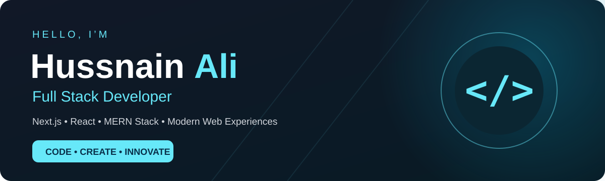
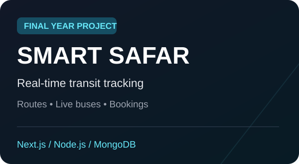
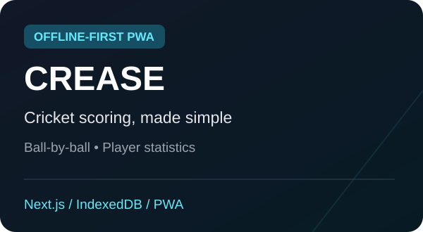
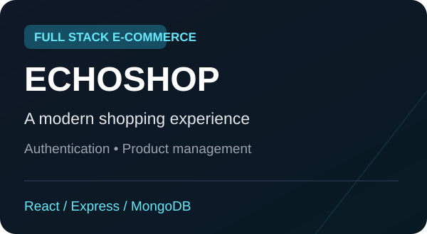

<div align="center">



<br /><br />

<a href="https://hussnainali-portfolio.vercel.app/"></a>
<a href="https://www.linkedin.com/in/hussnain-ali-01161a3a0/"></a>
<a href="mailto:hussnain.stack@gmail.com"></a>

</div>

<br />

## `> whoami`

<div align="center">

</div>

## `> cat skills.json`

<div align="center">

**Frontend**<br />


**Backend & Database**<br />


**Tools & Cloud**<br />


</div>

<br />

## `> ls ./projects`

<table>
<tr>
<td width="33%" valign="top">

<a href="https://github.com/hussnain-stack14/Smart-Public-Transit-Tracking-System"></a>

### 🚌 smart-safar
Final year project. Real-time transit tracking with routes, stops, and booking workflows.

`Next.js` `Node.js` `MongoDB` `Socket.IO`

[**Source Code ↗**](https://github.com/hussnain-stack14/Smart-Public-Transit-Tracking-System)

</td>
<td width="33%" valign="top">

<a href="https://crease-scoring.vercel.app/"></a>

### 🏏 crease
Offline-first cricket scoring PWA with ball-by-ball scoring, player stats, and team accounts.

`Next.js` `PWA` `IndexedDB`

[**Live App ↗**](https://crease-scoring.vercel.app/) · [**Code ↗**](https://github.com/hussnain-stack14/Cricket-Scoring-Web-App-)

</td>
<td width="33%" valign="top">

<a href="https://echoshop-hussnain.netlify.app/"></a>

### 🛒 echoshop
Full-stack e-commerce app with authentication, product management, and a responsive UI.

`React` `Express` `MongoDB` `JWT`

[**Live App ↗**](https://echoshop-hussnain.netlify.app/)

</td>
</tr>
</table>

<div align="center">
<a href="https://github.com/hussnain-stack14?tab=repositories"></a>
</div>

<br />

## `> git log --stats`

<div align="center">

</div>

<br />

## `> ./contact.sh`

```bash
$ echo "Have a project, internship, or idea to collaborate on?"
> Let's build something together.

$ mail --to hussnain.stack@gmail.com
```

<div align="center">


</div>
